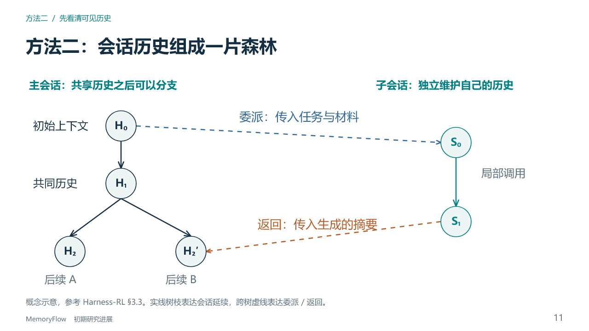

# MemoryFlow 研究进展汇报 v6

2026-11-01 生成，用于与另一模型的参考稿比较。依据已认可会议故事线和同日核准资料包。共 27 页，22 页主讲、5 页备选，建议主讲约 32 分钟。

- [可编辑 PPTX](MemoryFlow_研究进展汇报_v6.pptx)
- [PDF 版式预览](MemoryFlow_研究进展汇报_v6_预览.pdf)
- [逐页讲稿与更新说明](MemoryFlow_v6_逐页讲稿与更新说明.md)
- [核准内容与数据资料包](../../presentation_brief_20261101/README.md)

方法图、表格、图表和文字保留为可编辑对象。PDF 仅作预览，讲稿也写入 PPTX 备注。第 19 页正式来源链和第 20 页完整任务成本明确保留待补标记，没有把未核准结果写成实证。本次生成不代表新增研究实验。

比较两稿时，重点看研究价值是否清楚、方法二是否易懂、证据是否具体、已有结果与缺口是否区分。

